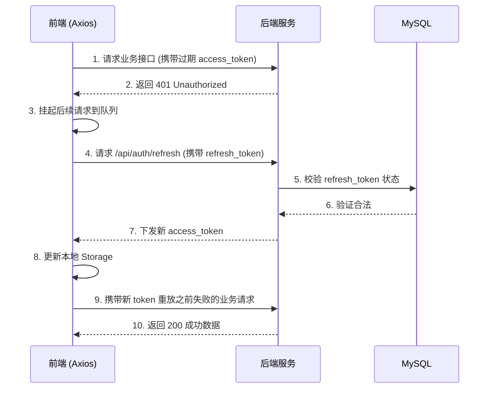
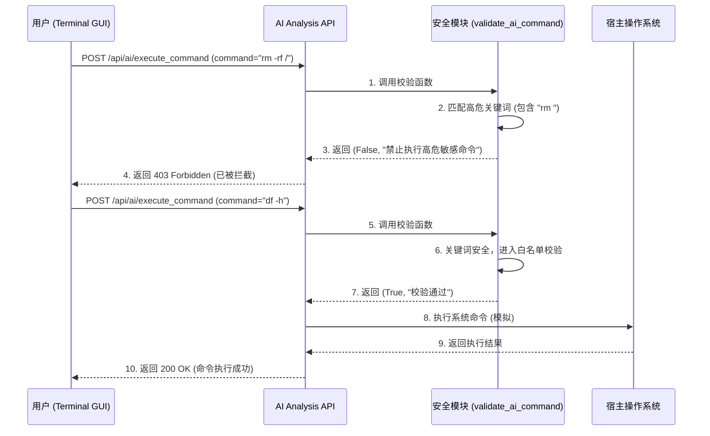

# 轻量化 AI 服务器运维防护系统 - 功能清单文档

[TOC]

## 1. 系统架构概述
本项目是一个基于前后端分离架构的**轻量化 AI 服务器运维防护系统**。
- **前端 (Frontend)**: 基于 Vue 3 + Vite + Element Plus 构建，提供数据大盘展示、AI 智能运维终端以及用户鉴权等可视化界面。
- **后端 (Backend)**: 基于 Flask 构建，集成了 JWT 双令牌认证、系统资源实时监控 (psutil)、AI 模型预测推理 (Isolation Forest + LSTM) 以及基于 Celery + Redis 的高并发异步数据接入。

---

## 2. 后端功能模块 (Backend)

### 2.1 认证与安全模块 (Auth & Security)
负责处理用户的注册、登录、Token 刷新、退出以及全局的权限拦截与安全加固。

#### 核心函数与方法
- **`register`** (`d:\dachuang\backend\routes\auth.py:32-80`)
  - **用途**: 处理新用户注册，校验密码复杂度并对密码进行 `bcrypt` 哈希后存入数据库。
  - **输入**: JSON `{username, email, password}`
  - **输出**: JSON `{code, message}`
  - **异常处理**: 捕获数据库插入异常，对于已存在的用户名/邮箱返回 `409 Conflict`。
  - **性能指标**: 密码哈希开销较大，注册接口限流（基于 IP）。

- **`login`** (`d:\dachuang\backend\routes\auth.py:82-137`)
  - **用途**: 验证用户凭据，下发 JWT 双令牌（Access Token 15分钟，Refresh Token 7天）。
  - **输入**: JSON `{username, password}`
  - **输出**: JSON 包含 `access_token`, `refresh_token`, `user_info`
  - **异常处理**: 密码错误返回 `401 Invalid credentials`。

- **`rbac_middleware`** (`d:\dachuang\backend\utils\security.py:18-42`)
  - **用途**: 全局拦截器，校验 Header 中的 `Bearer Token`，解析用户信息并挂载到 `request.user`。
  - **输入**: `req` (Flask Request), `secret_key` (str)
  - **输出**: 拦截返回 `401 JSON`，放行返回 `None`。

- **`security_headers_middleware`** (`d:\dachuang\backend\utils\security.py:44-56`)
  - **用途**: 添加安全响应头，防范 XSS、Clickjacking 等攻击 (`X-Content-Type-Options`, `X-Frame-Options` 等)。

### 2.2 监控指标模块 (Metrics)
获取当前宿主机的硬件资源使用情况。

#### 核心函数与方法
- **`get_current_metrics`** (`d:\dachuang\backend\routes\metrics.py:12-37`)
  - **用途**: 调用 `psutil` 获取 CPU、内存、磁盘的实时使用率。
  - **输入**: 无
  - **输出**: JSON 包含 `cpu_usage_percent`, `memory_used_percent` 等指标。
  - **异常处理**: 依赖底层系统调用，通常无显式异常抛出。
  - **性能指标**: 响应时间需 < 100ms。

### 2.3 AI 分析与预测模块 (AI Analysis)
利用 AI 模型进行异常检测与趋势预测，并提供自然语言运维命令的安全性校验。

#### 核心函数与方法
- **`predict_anomaly`** (`d:\dachuang\backend\routes\ai_analysis.py:11-80`)
  - **用途**: 接收服务器特征数据，加载 Isolation Forest 进行异常检测，加载 LSTM 进行时序预测。
  - **输入**: JSON `{features: [...], sequence: [...]}`
  - **输出**: JSON 包含 `is_anomaly` (bool), `predicted_trend` (float), `suggestion` (str)。
  - **异常处理**: 模型文件缺失或加载失败时，返回 Mock 降级数据，避免阻塞业务。

- **`validate_ai_command`** (`d:\dachuang\backend\utils\security.py:58-75`)
  - **用途**: 对传入的 AI 运维指令进行白名单校验与高危敏感词（如 `rm`, `sudo`, `reboot`）拦截。
  - **输入**: `command` (str)
  - **输出**: `is_valid` (bool), `message` (str)

- **`execute_command`** (`d:\dachuang\backend\routes\ai_analysis.py:82-108`)
  - **用途**: 经 `validate_ai_command` 拦截校验通过后，模拟下发系统指令。

### 2.4 异步数据接收模块 (Data Ingestion)
处理外部高并发上报的遥测数据，使用消息队列进行削峰填谷。

#### 核心函数与方法
- **`ingest_data`** (`d:\dachuang\backend\routes\data_ingestion.py:11-34`)
  - **用途**: 接收上报数据，利用 Redis 生成原子自增 `event_id`，投递至 Celery 队列。
  - **异常处理**: Redis 不可用时静默降级，继续投递 Celery 任务。
  - **性能指标**: API 响应极快 (< 20ms)，支持高并发接收。

- **`process_data_async`** (`d:\dachuang\backend\tasks.py:24-42`)
  - **用途**: Celery Worker 异步消费数据，执行数据清洗与入库 (`server_metric` 表)。
  - **异常处理**: 失败支持最多 3 次重试 (`max_retries=3`)，退避时间 5 秒。

---

## 3. 前端功能模块 (Frontend)

### 3.1 视图与路由层 (Views & Router)
- **全局路由守卫** (`d:\dachuang\frontend\src\router\index.js:39-49`)
  - **功能**: 根据本地 `access_token` 控制页面访问权限。未登录重定向至 `/login`，已登录拦截 `/login` 和 `/register`。
- **登录/注册页 (Login & Register)** (`d:\dachuang\frontend\src\views\Login.vue`, `Register.vue`)
  - **功能**: 收集凭据并调用后端认证接口；提供表单验证。改版后采用了 `AuthLayout.vue` 进行左右分栏美化布局。
- **控制台看板 (Dashboard)** (`d:\dachuang\frontend\src\views\Dashboard.vue`)
  - **功能**: 展示服务器 CPU/内存/IOPS 核心指标。集成 Echarts 渲染 LSTM 预测曲线，利用 Timeline 组件展示 Isolation Forest 拦截的异常事件。
- **AI 智能运维终端 (Terminal)** (`d:\dachuang\frontend\src\views\Terminal.vue`)
  - **功能**: 提供类似命令行的交互界面 (GUI)，支持输入自然语言或系统指令，调用后端 `/execute_command` 进行验证执行，并展示安全审计日志 (RBAC拦截记录)。

### 3.2 接口请求层 (API Request)
- **`axios` 拦截器** (`d:\dachuang\frontend\src\utils\request.js:13-74`)
  - **功能**: 
    1. 请求时自动附加 `Authorization: Bearer <token>`。
    2. 响应 401 时，触发无感刷新 Token 逻辑：暂停队列 -> 请求 `/refresh` -> 更新 Token -> 重放失败的请求。
    3. 全局统一处理 429 限流与其它异常提示。

---

## 4. 对外接口规格说明 (API/GUI Specification)

### 4.1 REST API 规格

| 模块 | 接口路径 | 方法 | 输入载荷 (JSON) | 输出格式 | 功能描述 | 权限 |
| --- | --- | --- | --- | --- | --- | --- |
| **Auth** | `/api/auth/register` | POST | `username`, `email`, `password` | `{code, message}` | 注册新用户 | 公开 |
| **Auth** | `/api/auth/login` | POST | `username`, `password` | `{code, data: {access_token, refresh_token}}` | 用户登录 | 公开 |
| **Auth** | `/api/auth/refresh` | POST | `refresh_token` | `{code, data: {access_token}}` | 刷新令牌 | 公开 |
| **Metrics** | `/api/metrics/current`| GET | 无 | `{code, data: {cpu, memory, disk}}` | 获取实时服务器监控指标 | 需登录 |
| **AI** | `/api/ai/predict` | POST | `features(list)`, `sequence(list)` | `{code, data: {is_anomaly, predicted_trend}}` | AI异常预测分析 | 需登录 |
| **AI** | `/api/ai/execute_command`| POST | `command(str)` | `{code, message, data: {stdout}}` | AI运维命令执行(带高危拦截) | 需登录 |
| **Data** | `/api/data/ingest` | POST | 任意遥测 JSON 数据 | `{status, eventId, message}` | 异步接收监控探针数据 | 公开 |

### 4.2 客户端 GUI 规格
- **`/login` (登录视图)**: 账号与密码输入框，校验失焦触发，底部附带跳转注册链接。
- **`/register` (注册视图)**: 用户名、邮箱、密码输入框，严格校验密码复杂度（包含大小写、数字、特殊字符）。
- **`/dashboard` (大盘视图)**: 四个核心指标卡（实时数字+趋势），LSTM时序曲线图表，异常事件时间轴。
- **`/terminal` (终端视图)**: 黑色代码风格输入框与历史回显窗口，底部表格显示审计放行/拦截记录。

---

## 5. 关键调用关系与流程图

### 5.1 模块间调用关系图

```mermaid
graph TD
    subgraph 前端应用 (Vue3)
        Router[Vue Router & 守卫]
        Axios[Axios 请求拦截与刷新]
        Views[Dashboard/Terminal 等视图]
    end

    subgraph 后端服务 (Flask)
        Auth[Auth 蓝图]
        Security[安全与权限中间件]
        Metrics[Metrics 蓝图]
        AI[AI Analysis 蓝图]
        Data[Data Ingestion 蓝图]
    end

    subgraph 异步任务系统
        Redis[Redis 缓存/计数器]
        Celery[Celery 消费者 Worker]
        DB[(MySQL 数据库)]
    end

    Views --> Axios
    Axios --> Router
    Axios -->|1. 携带 Token| Security
    Security -->|验证通过| Metrics
    Security -->|验证通过| AI
    Security -->|未携带/过期| Auth
    
    Data -->|生成自增ID| Redis
    Data -->|投递任务| Celery
    Celery -->|持久化| DB
    Auth --> DB
```

### 5.2 无感刷新 Token 时序图



### 5.3 智能运维命令安全执行流程

