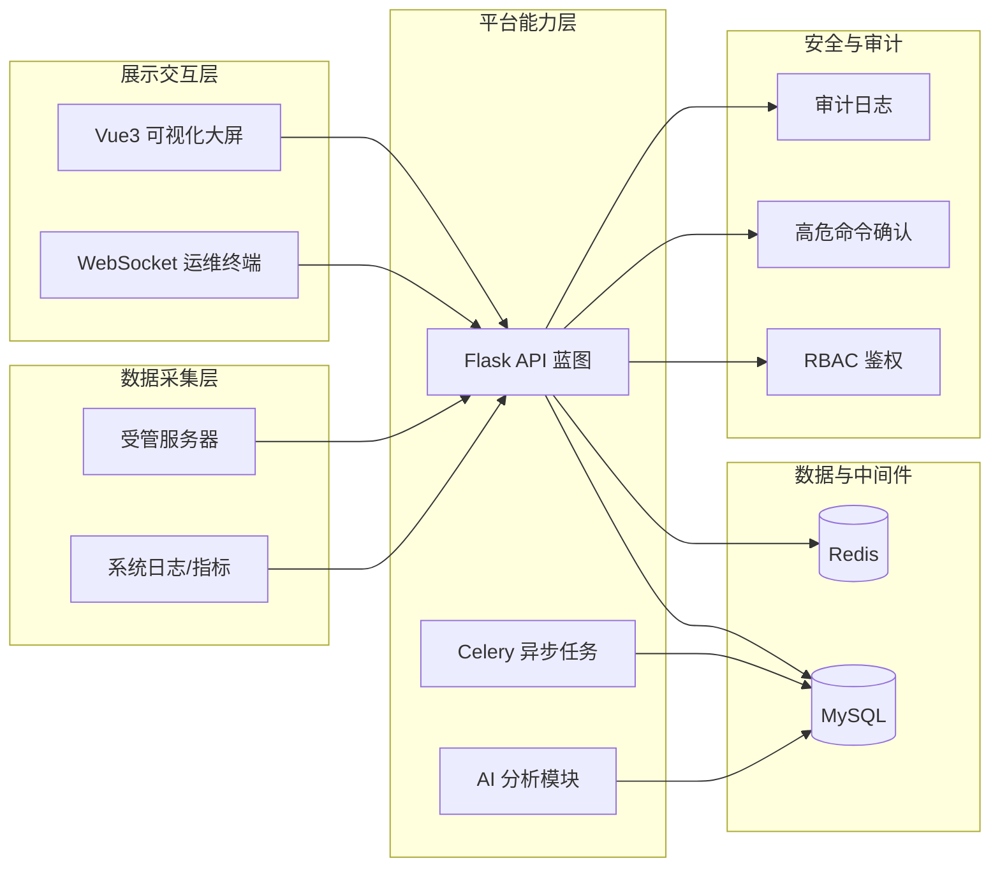
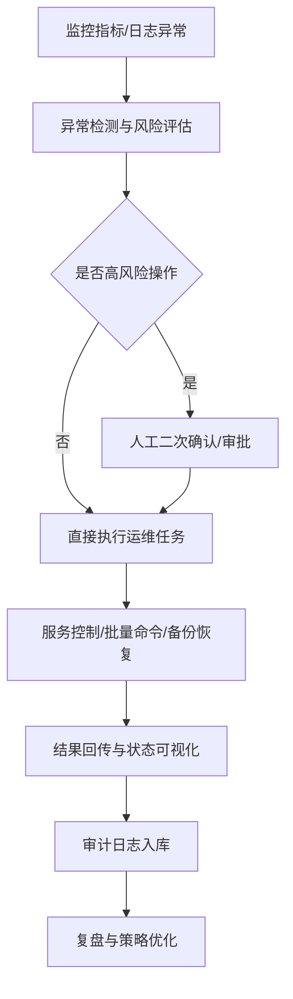

# 轻量化智能运维防护平台（答辩版）

## 1. 项目定位（一句话）

本项目面向中小团队的运维场景，提供“监控观测 + 智能分析 + 安全执行 + 审计追溯”一体化平台，目标是让运维流程从人工经验驱动升级为数据与策略驱动。

## 2. 架构图（答辩展示版）

> 建议讲解顺序：数据采集层 -> 平台能力层 -> 安全与审计层 -> 展示交互层。

### 2.1 补充：完整八层架构

完整版本可参考项目内文件：

- [docs/architecture_8_layers.mmd](docs/architecture_8_layers.mmd)

## 3. 核心业务流程图

> 场景：发现异常 -> AI 分析 -> 人工确认 -> 自动化执行 -> 审计闭环。

## 4. 关键页面截图位（可直接替换）

> 使用方法：把截图放到 docs/assets/demo/ 下并覆盖同名文件。

### 4.1 监控大屏

### 4.2 运维终端

### 4.3 服务管理

### 4.4 备份恢复中心

### 4.5 批量命令审批

## 5. 性能对比表（答辩可展示）

> 说明：下表给出“示例展示模板”。若用于正式答辩，请替换为压测或线上统计数据。

| 指标 | 传统人工方式（基线） | 本平台方式（当前） | 改善幅度 | 统计口径 |
|---|---:|---:|---:|---|
| 故障发现时间（MTTD） | 15 min | 5 min | 66.7% | 异常出现到被识别 |
| 故障恢复时间（MTTR） | 40 min | 18 min | 55.0% | 告警到恢复完成 |
| 高危命令误执行率 | 2.5% | 0.6% | 76.0% | 按月统计 |
| 批量运维任务平均耗时 | 30 min | 9 min | 70.0% | 10 台服务器并行 |
| 审计可追溯覆盖率 | 45% | 95% | +50 pct | 关键操作留痕比例 |

## 6. 业务价值与创新点（答辩要点）

1. 一体化能力整合：监控、终端、服务管理、备份恢复、文件管理、批量审批、AI 助手统一入口。
2. 安全前置：高危操作确认 + 审批 + 审计，形成可追责执行链路。
3. 真实数据驱动：支持来自受管服务器的实时指标采集，而非纯前端模拟。
4. 可扩展架构：后端蓝图化和异步任务机制便于持续扩展业务模块。

## 7. 答辩讲解建议（5~8 分钟）

1. 背景与痛点（1 分钟）：人工运维碎片化、响应慢、追溯难。
2. 架构设计（2 分钟）：讲清采集、分析、执行、审计四条主线。
3. 核心流程演示（2 分钟）：异常识别 -> 审批确认 -> 执行 -> 审计回放。
4. 性能结果（1 分钟）：使用对比表突出效率和安全收益。
5. 总结与展望（1 分钟）：多集群、更多 AI 模型、策略自动化。

## 8. 现场演示清单（防遗忘）

- 登录并展示角色权限差异。
- 打开监控大屏，切换时间窗口。
- 在服务管理中重启一个非关键服务（演示前确认环境安全）。
- 创建一条批量命令任务并完成审批。
- 查看审计日志，证明全流程可追溯。
